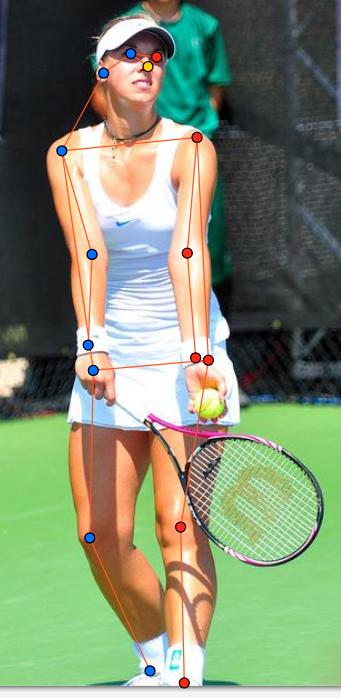
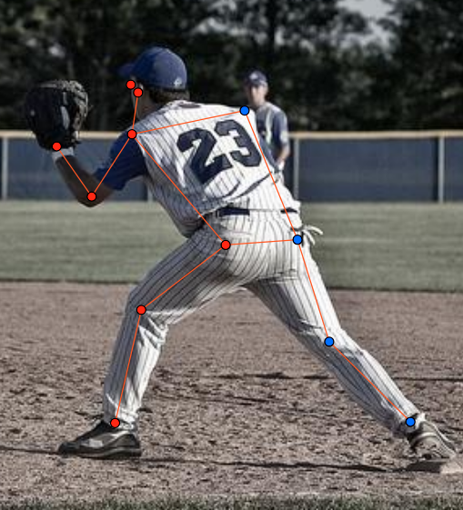
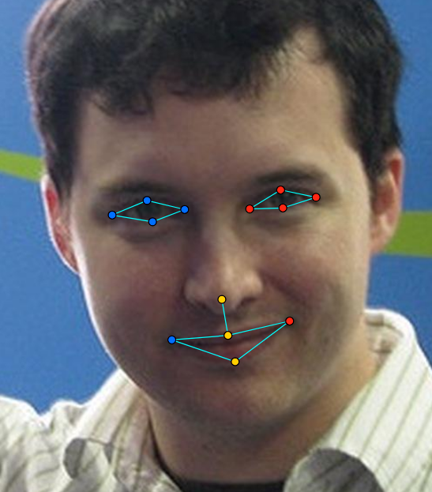
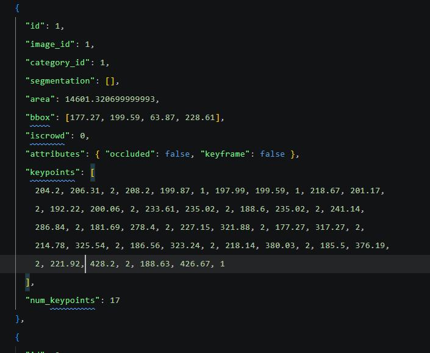

# Báo cáo thực hành — Lab Ngày 4 (Keypoint & Pose)

## 0. Thông tin học viên

- Họ tên: Phạm Thị Lương
- MSSV: 2A202603302
- Email: 26ai.luongpt@vinuni.edu.vn
- Link repository: https://github.com/luw369/K5-L2B-DAY04-PhamThiLuong-2A202603302-KeypointPose-Student.git
- Phiên bản CVAT (Help → About): CVAT 2.82.1
- Máy: Hệ điều hành Windows · RAM 16 GB · chạy CVAT chế độ đầy đủ
- Bộ ảnh (`src/exports/assignment.json` do `lab.py setup` tạo): Có
- Giờ bắt đầu: 16h00
- Giờ kết thúc: 18h30

## 1. Kiểm tra label (CP0)

| Label | Kiểu | Số điểm | Tên điểm đúng bảng của lab? | Đúng thứ tự? | Số cạnh |
|---|---|---:|---|---|---:|
| `person` | `skeleton` | 17 | Có | Có | 19 |
| `face` | `skeleton` | 13 | Có | Có | 13 |

Mẫu `person` dựng theo người quay mặt về camera (các điểm `left_*` nằm bên phải khung mẫu)? **Có**

Cách đổi cờ `occluded` / `outside` cho **một điểm** trên phiên bản CVAT này (một câu): Chọn đúng keypoint cần chỉnh trên Skeleton, mở bảng thuộc tính bên phải (hoặc click chuột phải vào điểm), rồi đổi thuộc tính `Visibility` của điểm đó thành `occluded` hoặc `outside`.

## 2. Số lượng đã gán và thời gian (CP1, CP2)

| Nhóm ảnh | Số ảnh | Số skeleton đã gán | Số người dưới 60 px (không gán) | Số poster / gương / màn hình bỏ qua | Thời gian (phút) |
|---|---:|---:|---:|---:|---:|
| `easy` | 5 | 5 | 0 | 0 | 20 |
| `occluded` | 3 | 5 | 0 | 0 | 25 |
| `back` | 2 | 3 | 1 | 0 | 25 |
| `small` | 1 | 0 | 2 | 0 | 10 |
| `crowd` | 1 | 3 | 0 | 0 | 20 |
| `faces` | 8 | 8 | — | 0 | 25 |

- Số ảnh người đã xong ở mốc phút 105: `12 / 12`
- Thời gian thực tế (phút): CP1 `65` · CP2 `35` · CP3 `25`
- Ảnh tốn thời gian nhất là ảnh nào, vì sao?
  Ảnh tốn thời gian nhất là ảnh nhóm `crowd` (`000000272026.jpg`, 3 người ngồi quanh bàn ăn) và ảnh nhóm `back` (`000000393909.jpg`, 2 cầu thủ bóng chày). Nguyên nhân là các nhân vật có tư thế xoay nghiêng/quay lưng và bị bàn ăn hoặc cơ thể che khuất một phần chi dưới, đòi hỏi phải xác định kỹ hướng từng người để tránh lỗi đổi trái/phải (`lr_swap`) và cân nhắc từng khớp bị che giữa cờ `v = 1` và `v = 0`.

## 3. Bảng ca khó (CP1, CP2)

| Ảnh | Người / mặt | Điểm | Cờ đã chọn | Phân vân giữa | Lý do chọn |
|---|---|---|---:|---|---|
| `000000323705.jpg` | 2 bóng người đứng trên hành lang xa sau đồng hồ | Toàn bộ 17 điểm | — (không gán) | Tạo skeleton toàn `v = 0` và bỏ qua không gán | Hai người ở rất xa hậu cảnh, chiều cao dưới 60 px và bị mờ out-of-focus hoàn toàn nên không thể xác định vị trí bất kỳ khớp nào; theo quy tắc lab không gán và đếm vào báo cáo. |
| `000000493741.jpg` | Người trượt tuyết (`PERSON 127`) | `left_eye`, `right_eye` | 1 | `v = 1` và `v = 0` | Nhân vật đeo kính trượt tuyết tối màu che mắt nhưng qua gọng kính và sống mũi có thể ước lượng chắc chắn vị trí hai mắt nên đặt `occluded` (`v = 1`). |
| `000000393909.jpg` | Cầu thủ chạy bên trái (`PERSON 73`) | `right_ankle` | 0 | `v = 0` và `v = 1` | Bàn chân phải co ra phía sau bị cắt hẳn ra ngoài mép trái khung ảnh; tuân thủ quy tắc không kéo điểm về mép ảnh nên gán `outside` (`v = 0`). |
| `000000272026.jpg` | Người phụ nữ áo trắng bên trái | `left_hip`, `right_hip`, `right_knee` | 1 | `v = 1` và `v = 0` | Vùng hông và đầu gối bị mặt bàn ăn che khuất nhưng vẫn nhìn thấy hướng đùi và dáng ngồi nghiêng nên ước lượng được tâm khớp chắc chắn (`v = 1`). |

## 4. Bảng tự review (CP3)

| Ảnh | Người / mặt | Điểm | Mã lỗi | Ghi chú | Đã sửa? |
|---|---|---|---|---|---|
| `000000516902.jpg` | Người 1 (`back`) | Toàn bộ 17 điểm | `ok` | Người quay lưng hoàn toàn, đã đổi trái/phải chuẩn theo hướng người, mắt/mũi để `outside` (`v = 0`). | — |
| `000000493741.jpg` | `PERSON 127` (trượt tuyết) | `left_ankle`, `right_ankle`, `knee` | `lr_swap` | Hai đường nối gối – cổ chân bắt chéo hình chữ X do đặt ngược trái/phải cổ chân; đã tráo lại `right_ankle` (gần camera) và `left_ankle` (xa camera). | Có |
| `000000451084.jpg` | Người 1 (`easy`) | Toàn bộ 17 điểm | `ok` | Phóng to đặt chuẩn tâm khớp mắt, mũi, vai và hông; cờ `v = 2` chính xác. | — |
| `000000393909.jpg` | `PERSON 23` (bên phải, `back`) | `shoulder`, `elbow`, `wrist` | `lr_swap` | Người quay lưng nhưng nửa thân trên gán ngược trái/phải làm đường nối vai – hông vắt chéo chữ X; đã đảo lại tay đeo găng sang `left_*`. | Có |
| `000000393909.jpg` | `PERSON 73` (bên trái, `back`) | `left_hip`, `right_hip`, `left_knee`, `right_knee` | `lr_swap` | Người chạy nghiêng sang phải nhưng cụm hông và gối bị gán ngược chiều so với vai; đã tráo lại chân co phía sau sang `right_*` và chân bước trước sang `left_*`. | Có |
| `000000272026.jpg` | Người 1 (áo trắng bên trái, `crowd`) | `left_shoulder`, `right_shoulder` | `lr_swap` | Hai đường nối vai – khuỷu tay bắt chéo trước ngực do đặt ngược vai trái/phải; đã đổi lại `right_shoulder` về phía tay chống cằm. | Có |
| `face_92028.jpg` | Khuôn mặt 1 | `left_eye_upper`, `right_eye_upper` | `position` | Điểm mí trên hơi lệch lên viền lông mày khi chưa zoom kỹ; đã phóng to và kéo về sát mép mí trên ngay trên tâm con ngươi. | Có |
| `face_79367.jpg` | Khuôn mặt 1 | Toàn bộ 13 điểm | `ok` | Mặt nhìn thẳng rõ nét, 13 điểm đặt đúng khóe mắt, mí mắt, chóp mũi và môi (`v = 2`). | — |
| `face_514826.jpg` | Khuôn mặt 1 | `left_eye_outer`, `left_eye_lower` | `vis_flag` | Mặt nghiêng khiến khóe ngoài mắt xa bị sống mũi che khuất một phần, ban đầu để `v = 2`, đã chuyển sang `occluded` (`v = 1`). | Có |

Tổng hợp số lỗi theo mã:

| `lr_swap` | `vis_flag` | `position` | `missing` | `extra` | `ok` |
|---:|---:|---:|---:|---:|---:|
| 4 | 1 | 1 | 0 | 0 | 3 |

Điểm còn phân vân giữa `v = 1` và `v = 0` (ghi cả hai lựa chọn và lý do chọn):
- Điểm `right_elbow` và `right_wrist` của cầu thủ `PERSON 23` trong ảnh `000000393909.jpg`: phân vân giữa `v = 1` (cánh tay phải gập trước ngực bị thân người che khuất) và `v = 0`. Cuối cùng chọn `v = 0` (`outside`) vì tay phải nằm khuất hoàn toàn phía trước thân trên đang quay lưng, không nhìn thấy một đoạn chi nào để làm mốc suy luận nên nếu ước lượng sẽ bị tản mát giữa các người gán khác nhau.

## 5. Kiểm file xuất và kết quả tự kiểm (CP4)

Tự kiểm tay trong file JSON:

| File | Người / mặt kiểm (ảnh, thứ tự) | Số phần tử `keypoints` | Điểm `outside` ra `v = 0`, `occluded` ra `v = 1`? | `num_keypoints` khớp? |
|---|---|---:|---|---|
| `PhamThiLuong_persons.zip` | `000000393909.jpg`, người thứ 1 | 51 | Có | Có |
| `PhamThiLuong_persons.zip` | `000000493741.jpg`, người thứ 1 | 51 | Có | Có |
| `PhamThiLuong_faces.zip` | `face_79367.jpg`, mặt thứ 1 | 39 | Có | Có |

Sau khi xuất, CVAT ghi `occluded` thành `v = 1` và `outside` thành `v = 0`. Tọa độ của điểm `outside` trong file là `0, 0` hay tọa độ cũ? **tọa độ cũ**

Hai job đã chuyển sang completed trên CVAT? **Có**

Dán phần **TÓM TẮT** in ra từ `src/check_submission.py`:

```text
----- TÓM TẮT (dán vào báo cáo mục 5) -----
- File person: PhamThiLuong_persons.zip
  Số ảnh: 12 · số skeleton `person`: 16 · mỗi annotation 51 số
  Skeleton theo ảnh: 000000057978=1, 000000069971=2, 000000123544=2, 000000189365=1, 000000196283=1, 000000225138=1, 000000272026=3, 000000323705=0, 000000393909=2, 000000451084=1, 000000493741=1, 000000516902=1
  Cờ v: v=2 190 (70%) · v=1 22 (8%) · v=0 60 (22%)
  num_keypoints trung bình: 13.2
- File face: PhamThiLuong_faces.zip
  Số ảnh: 8 · số skeleton `face`: 8 · mỗi annotation 39 số
  Skeleton theo ảnh: face_146049=1, face_232598=1, face_264124=1, face_300399=1, face_356144=1, face_514826=1, face_79367=1, face_92028=1
  Cờ v: v=2 92 (88%) · v=1 0 (0%) · v=0 12 (12%)
  num_keypoints trung bình: 11.5
- Ghi chú: 72 điểm v = 0 vẫn mang tọa độ cũ (CVAT 2.x xuất như vậy; chuẩn COCO ghi 0, 0). Không phải lỗi: điểm v = 0 bị bỏ qua khi huấn luyện và khi chấm.
- Số [LỖI]: 0 · số [CẢNH BÁO]: 1
Kết quả: ĐẠT (đọc lại từng cảnh báo ở trên)
```

Các `[CẢNH BÁO]` còn giữ nguyên và lý do:
- `[CẢNH BÁO] 000000323705.jpg: không có skeleton person nào. Ảnh nào cũng có ít nhất một người cần gán.`
- **Lý do giữ nguyên:** Trong ảnh `000000323705.jpg` (chụp chiếc đồng hồ lớn ở nhà ga), chỉ có 2 bóng người đứng rất xa trên hành lang phía sau, bị mờ nhòe hoàn toàn do lệch nét (out-of-focus) và có chiều cao dưới 60 px. Theo đúng quy định ở Mục 3 và Mục 5 của lab (*"Người cao dưới 60 px: không gán, đếm vào báo cáo"* và *"không điền đủ 17 điểm bằng mọi giá"*), không tạo skeleton giả cho ảnh này để tránh đưa dữ liệu nhiễu vào tập nhãn, đồng thời đã ghi nhận 2 người này vào bảng thống kê ở Mục 2.

## 6. Ảnh chụp màn hình

1. Label `person` trong label constructor (đủ 17 điểm có tên):

   

2. Một người quay lưng đã gán, cờ đã đặt:

   

3. Một khuôn mặt đã gán 13 điểm, phóng to vùng mắt:

   

4. Một đoạn JSON xuất của một người:

   

Nguồn ảnh: COCO val2017 / Wikimedia Commons.

## 7. Tự đánh giá

1. **Lỗi bạn mắc nhiều nhất hôm nay, và cách bạn sẽ tránh ở dự án thật:**
   Lỗi mắc nhiều nhất là `lr_swap` (đổi nhầm trái/phải ở cặp vai, hông hoặc cổ chân khi nhân vật quay lưng hoặc chạy nghiêng). Ở dự án thật, để tránh lỗi này tôi sẽ tuân thủ quy trình 3 bước trước khi lưu mỗi khung hình: (1) xác định và đọc thành tiếng hướng quay của người trước khi kéo mẫu skeleton; (2) tự đặt mình vào tư thế nhân vật để đối chiếu bên trái/phải; (3) nhìn tổng thể các đường nối (edges) xem có đường nào bắt chéo chữ X bất thường ở thân trên hoặc cẳng chân hay không.

2. **Một quy tắc bạn đề xuất thêm vào guideline (kèm ảnh ví dụ nếu có):**
   Bổ sung quy tắc xử lý trường hợp **người bị mờ nặng do lệch nét (heavy out-of-focus / motion blur) ở hậu cảnh**: ngay cả khi chiều cao nhân vật xấp xỉ hoặc nhỉnh hơn 60 px một chút, nếu không thể phân biệt ranh giới giữa đầu, vai và các khớp chi để đặt ít nhất một điểm `v = 1` hoặc `v = 2` chắc chắn thì được phép bỏ qua không tạo skeleton (tương tự nhóm `small`) và ghi nhận vào bảng thống kê.

3. **Nhãn của bạn đi vào model ở đâu? Chọn một lỗi bạn đã sửa và nói nó sẽ làm model học sai thế nào (heatmap, trọng số trong loss, hay bước lật ảnh):**
   Tọa độ và cờ `v` của từng keypoint được dùng để sinh ra các bản đồ nhiệt Gaussian 2D (ground-truth heatmaps) trên 17 kênh riêng biệt làm mục tiêu huấn luyện cho mạng neural. Khi mắc lỗi `lr_swap` (ví dụ đặt nhầm `left_shoulder` sang vị trí vai phải của người phụ nữ trong ảnh `000000272026.jpg`), đỉnh xác suất trên heatmap của kênh `left_shoulder` sẽ nằm sai ở vai phải. Đặc biệt, trong bước tăng cường dữ liệu lật ảnh ngang (horizontal flip) vốn tự động hoán đổi nhãn cặp `left_*` ↔ `right_*`, dữ liệu sai này sẽ tạo ra tín hiệu giám sát mâu thuẫn với các ảnh đúng khác, khiến hàm loss không hội tụ tốt và model dự đoán nhầm lẫn hoặc chia đôi điểm dự đoán giữa hai bên vai.

## 8. Khó khăn và lỗi kỹ thuật

- **Thao tác lưu trên CVAT 2.82.1:** Khi kéo sửa vị trí các điểm bị `lr_swap`, nếu chưa bấm `Ctrl+S` để đồng bộ lên server trước khi xuất file COCO Keypoints 1.0 thì file ZIP xuất ra vẫn giữ tọa độ cũ khiến script `check_submission.py` tiếp tục báo lỗi.
- **Phân biệt thuộc tính hiển thị và cờ xuất dữ liệu:** Cần chú ý không dùng phím tắt `H` (`hidden`) để ẩn các điểm bị che vì `hidden` chỉ ẩn trên giao diện chứ không chuyển cờ thành `occluded` (`v = 1`) hay `outside` (`v = 0`) khi xuất JSON.
- **Xử lý cảnh báo ảnh không có người (`000000323705.jpg`):** Script tự kiểm mặc định cảnh báo khi một ảnh có `0` skeleton, cần đối chiếu kỹ guideline để tự tin giữ nguyên kết quả đúng quy tắc thay vì cố tạo skeleton giả chỉ để xóa cảnh báo.

## 9. Tài liệu tham khảo và công cụ AI đã dùng

- **Tài liệu tham khảo:** Tài liệu *Quy ước nhãn — Lab Ngày 4 (Keypoint & Pose)*; tài liệu chuẩn định dạng COCO Keypoints Detection; hướng dẫn sử dụng CVAT 2.82.
- **Công cụ AI đã dùng:** Sử dụng Gemini để đối chiếu hình ảnh trực quan phát hiện các điểm bị bắt chéo trái/phải (`lr_swap`), kiểm tra logic gán cờ visibility (`v = 0, 1, 2`) cho các ca bị che khuất/ngoài khung hình, và hỗ trợ tổng hợp, rà soát cấu trúc báo cáo thực hành.